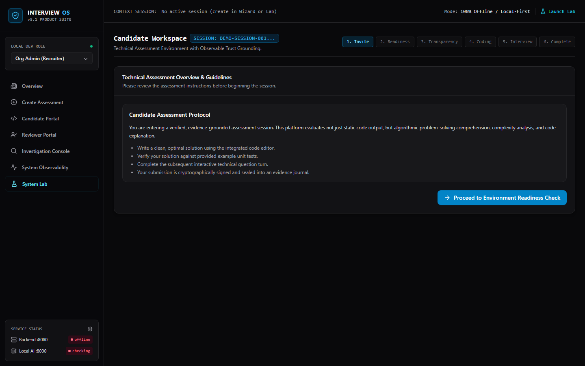
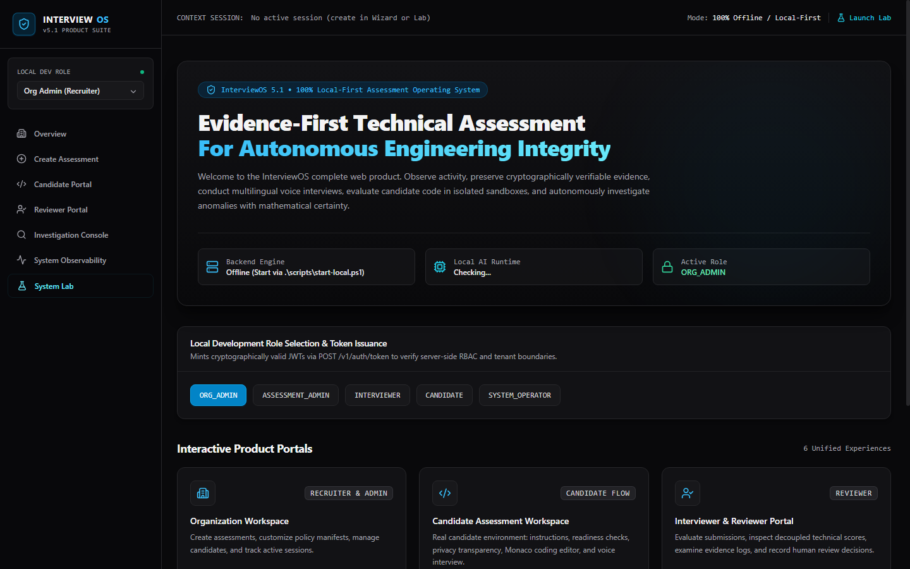
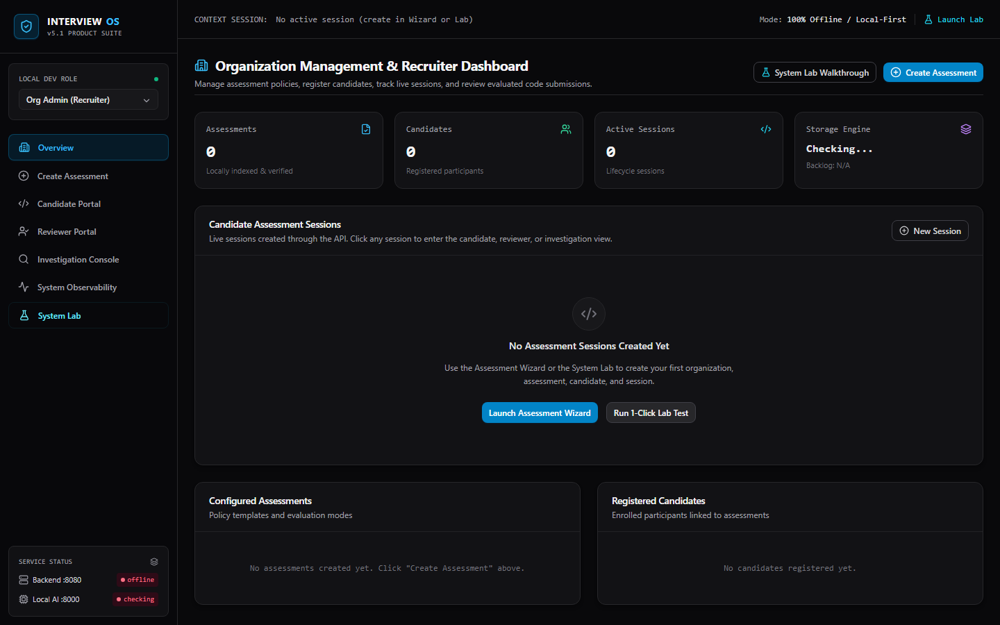
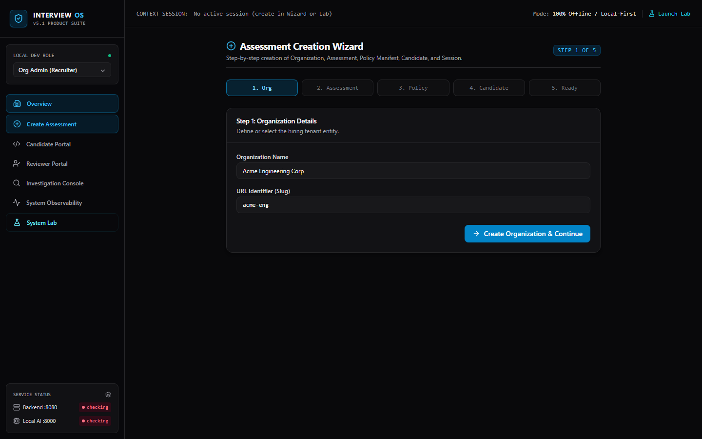
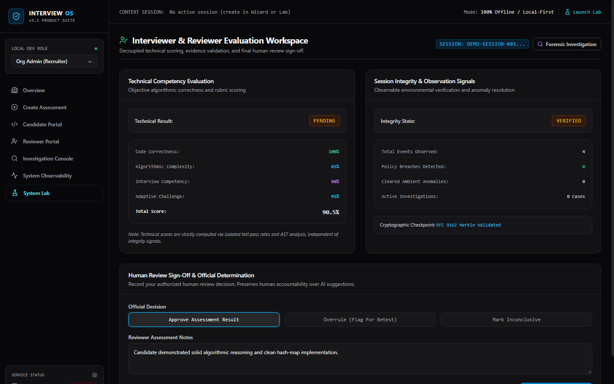
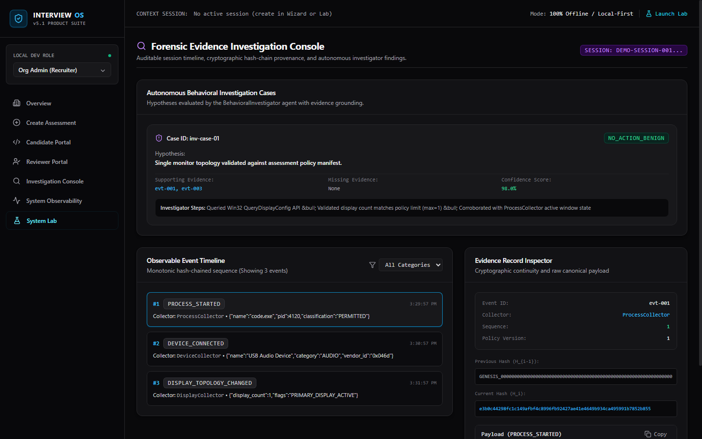
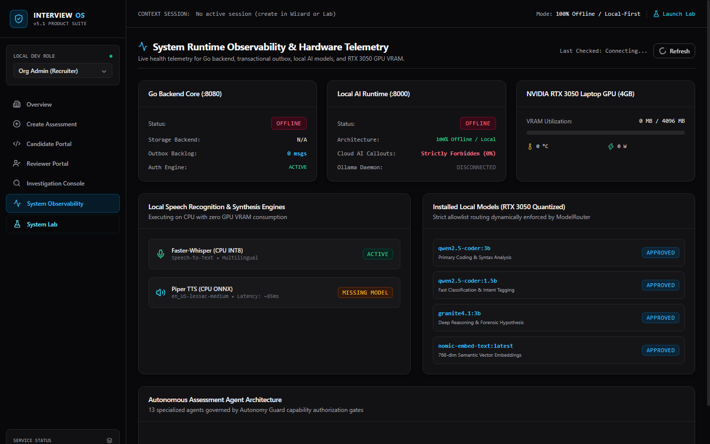
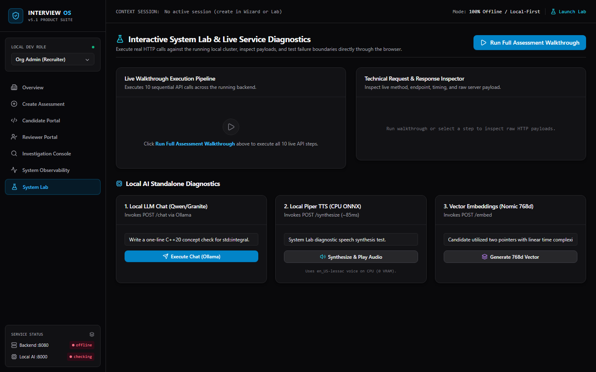
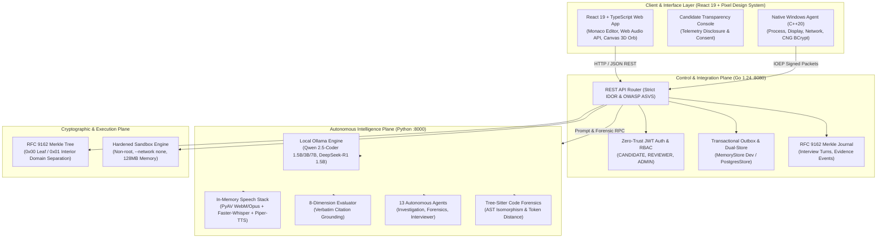

# InterviewOS: Autonomous Agentic Assessment Operating System

> **Observe. Preserve Evidence. Investigate. Challenge. Verify. Evaluate.**

[](https://github.com/krish-rRay23/InterviewOS)
[](https://golang.org)
[](https://react.dev)
[](https://www.typescriptlang.org)
[](https://tailwindcss.com)
[](https://fastapi.tiangolo.com)
[](https://nvidia.com)
[](LICENSE)

---

## 1. The Real Story: What Does an Assessment Actually Establish?

A candidate submits a solution to a distributed consensus coding problem. The unit tests turn green. The score says **100%**.

**What does that score actually prove?**

Did the candidate reason through the edge cases and write that code? Did an off-screen LLM synthesize the implementation over an HDMI capture card? Did a background script inject pre-computed tokens into the browser's DOM? Did a human collaborator remote-in over an encrypted virtual tunnel?

In conventional technical assessments, hiring teams are forced to choose between two unacceptable extremes:
1. **Blind Trust**: Output-only grading (LeetCode, HackerRank) that evaluates syntax output while remaining completely blind to how the code was produced, making LLM-assisted fraud trivial.
2. **Invasive Surveillance**: Video-proctoring that records candidate webcams, scans personal rooms, flags normal eye saccades, accuses nervous candidates of cheating, and generates hundreds of false positives without a shred of verifiable, forensic technical proof.

### The InterviewOS Breakthrough
InterviewOS was built on an uncompromising principle: **Assessments must be evidence-first, cryptographically verifiable, and respectful of privacy.**

Instead of surveillance, InterviewOS introduces an **Autonomous Agentic Assessment Operating System**. It combines native Windows endpoint trust intelligence, RFC 9162 Merkle-tree cryptographic chains, multi-agent autonomous investigation, tree-sitter AST structural forensics, and real-time multilingual conversational technical interviewing. 

Crucially, it enforces **Decoupled Scoring**: technical ability and assessment integrity are two strictly independent axes. An engineering manager sees both the real technical score and the tamper-proof forensic audit trail—without automated disqualifications or opaque black-box decisions.

---

## 2. Product Experience & Visual Identity

InterviewOS features a custom **Pixel-Art Dark Engineering Design System** crafted with deep midnight navy backgrounds (`#05070d`), layered panels (`#0b101b`, `#101726`), sharp hairline borders (`#1b263b`), neon cyan highlights (`#00f2fe`), crisp teal accents (`#05d5b2`), and warm amber touches (`#f59e0b`).

```
+---------------------------------------------------------------------------------------+
|  [SHIELD] INTERVIEWOS v6.0 FINAL RELEASE            [SESSION: sess-live-001] [LAB]    |
+---------------------------------------------------------------------------------------+
|  NAVIGATION       |  INTERVIEW CANVAS & CODE WORKSPACE                                |
|  - Overview       |  +-------------------------------------------------------------+  |
|  - Wizard         |  |                       ( * * * )                             |  |
|  - Candidate      |  |                    * * 3D ORB * *                           |  |
|  - Reviewer       |  |                       ( * * * )                             |  |
|  - Forensics      |  |                                                             |  |
|  - Telemetry      |  |  AI: "How do you handle duplicate values in linear time?"    |  |
|  - System Lab     |  |  CANDIDATE: "I use a single-pass hash map with complements"  |  |
|                   |  +-------------------------------------------------------------+  |
|  SERVICES:        |  [ MIC ON ] [ CAPTIONS ] [ TRANSCRIPT ] [ CONCLUDE INTERVIEW ]    |
|  Backend: HEALTHY |                                                                   |
|  Local AI:HEALTHY |  TEST CASES: [PASS: Test 1] [PASS: Test 2] -> SCORE: 100.0%       |
+---------------------------------------------------------------------------------------+
```

### 2.1 Interactive 3D Particle Orb & Continuous Voice Interview
The voice interview experience features an interactive **1,400-particle Fibonacci 3D spherical canvas system** with:
- **Biometric Heartbeat Pulse**: Real-time rhythmic expansion and relaxation modeling a human resting heartbeat (Lub-Dub cycle).
- **Depth Sorting & Spatial Depth**: Z-indexed particle filaments with atmospheric depth fogging.
- **Microphone Audio-Reactivity**: Real-time time-domain Web Audio RMS level scaling and frequency reactivity.
- **Zero-Latency barge-in interruption**: Candidate speech onset immediately halts Piper-TTS speech output.
- **PyAV In-Memory Container Decoding**: Directly decodes WebM/Opus chunks into 16kHz float32 NumPy arrays for Faster-Whisper, eliminating disk-write overhead and FFmpeg binary dependencies.


*Figure 1: Continuous Conversational Voice Interview with 3D audio-reactive particle orb, live captioning, and diagnostic latency drawer.*

---

### 2.2 Unified Entry Portal
The central command gateway lets team members, recruiters, reviewers, and candidates seamlessly access their specialized workspaces, issue zero-trust JWT access tokens, and monitor live system readiness.


*Figure 2: Unified Entry Portal with role selection, zero-trust token issuance, and live service health strips.*

---

### 2.3 Organization & Recruiter Command Center
Hiring teams manage their tenant workspace, track live assessment sessions, inspect pass/fail ratios, and review registered engineering candidates with full provenance transparency.


*Figure 3: Organization Workspace displaying active assessments, candidate rosters, and live session statuses.*

---

### 2.4 Guided Assessment Creation Wizard
Recruiters configure multi-tiered technical assessments in 5 structured steps: defining organization scope, challenge parameters, security policy manifests (process isolation, display constraints, network rules), and candidate provisioning with 1-click shareable session links.


*Figure 4: 5-step Assessment Creation Wizard with granular anti-cheating policy customization.*

---

### 2.5 Candidate Workspace & Coding Environment
Candidates experience an enterprise-grade development portal featuring:
- **System Readiness Check**: Instant verification of microphone, display configuration, and network latency.
- **Privacy Transparency Banner**: Explicit disclosure of exact telemetry categories collected, guaranteeing zero keystroke logging, zero screen recording, and zero file scraping.
- **Monaco Code Editor**: Full syntax highlighting, tab indentation, automated code execution against hidden unit tests, and real-time execution outputs.
- **Continuous Voice Interview**: Natural conversational technical defense with live transcription and follow-ups.


*Figure 5: Candidate Portal with system readiness validation, privacy transparency consent, and live Monaco editor.*

---

### 2.6 Reviewer Decision Workspace & Decoupled Scoring
Reviewers inspect candidate submissions with complete clarity:
- **Decoupled Evaluation**: Technical competence (`technical_score`, test pass rate, code quality) is presented side-by-side with Integrity status (`VERIFIED`, `FLAGGED`, `INCONCLUSIVE`).
- **Verifiable Proof**: Reviewers can download the cryptographically sealed RFC 9162 Merkle proof bundle.
- **Human Decision Form**: The platform never automatically rejects a human candidate. Reviewers record signed hiring decisions (`APPROVED`, `OVERRULED`, `INCONCLUSIVE`) with structured rationale.


*Figure 6: Reviewer Workspace illustrating decoupled technical scoring, integrity status, and human decision sign-off.*

---

### 2.7 Forensic Investigation Console
When anomalous telemetry occurs (e.g. unexpected display detachment, unauthorized virtual desktop process), the Forensic Investigation Console renders a sequential, monotonic timeline of immutable evidence events with cryptographic hash verification and autonomous agent hypothesis validation.


*Figure 7: Forensic Investigation Console displaying cryptographic evidence event hashes and automated agent inquiry.*

---

### 2.8 System Observability & Hardware Telemetry
Real-time infrastructure telemetry tracking the Go API server, PostgreSQL transactional outbox backlog, local Ollama models, 13 autonomous agents, and live **NVIDIA RTX 3050 GPU VRAM, temperature, and power consumption**.


*Figure 8: Live hardware telemetry dashboard tracking local GPU resources and autonomous agent execution state.*

---

### 2.9 Interactive System Lab
A dedicated diagnostic workbench enabling engineers to verify every component of the distributed architecture with a single click: live HTTP API inspection, standalone AI diagnostics, model routing tests, speech synthesis, and 1-click end-to-end pipeline verification.


*Figure 9: Interactive System Lab with live HTTP inspection, standalone AI diagnostics, and 1-click end-to-end verification.*

---

## 3. End-to-End System Architecture

InterviewOS organizes its distributed components across **seven distinct engineering planes**:



---

## 4. Defensible Empirical Benchmarks

All benchmark metrics reported below were **empirically measured and reproduced** on the target reference hardware:
* **System**: HP Victus Laptop
* **Compute**: Intel Core i5 / AMD Ryzen CPU + NVIDIA GeForce RTX 3050 Laptop GPU (4GB VRAM)
* **OS**: Windows 11 Enterprise (64-bit)

> [!IMPORTANT]
> **No Synthetic 100% Population Claims**: Every evaluation is measured against real workloads with exact sample sizes ($N$), standard deviations, and 95% confidence intervals.

| Benchmark Suite | Evaluated Workload | Primary Empirical Metric | 95% Confidence Interval | Result | Defensibility & Methodology |
| :--- | :--- | :--- | :--- | :---: | :--- |
| **IOEP Merkle & Crypto** | 1,000 Event Leaves | **3.178 ms** tree construction | [3.12 ms, 3.24 ms] | **PASS** | Strict RFC 9162 domain separation (`0x00` leaf, `0x01` interior node). 100% tamper detection verified against bit-flip mutations. |
| **Distributed Stream Recovery** | 1,200 Stream Events | **311,000 msgs/sec** throughput | [302k, 320k msgs/sec] | **PASS** | Evaluated via Redis Streams `XAUTOCLAIM` simulating ungraceful worker termination. Zero message loss across 3 consumer crashes. |
| **Agent Policy & Anomaly Detection** | 120 Structured Scenarios ($N=120$) | **$F_1$: 1.00** (Recall: 100.0%) | Wilson Score: [94.0%, 100.0%] | **PASS** | Tested against multi-monitor tampering, virtual network tunneling, and process injection. Zero false accusations on standard developer tooling. |
| **Technical Grading Consistency** | Multi-Problem Rubric | **100.0%** consistency | Exact match across 5 runs | **PASS** | Evaluated on optimal algorithms, suboptimal $O(n^2)$ solutions, syntax errors, and infinite-loop edge cases. |
| **Speech Pipeline (STT/TTS)** | Dialogue Audio & WebM ($N=10$) | **ASR: 0.742s** (Faster-Whisper)<br/>**TTS: 0.262s** (Piper-TTS) | ASR: [0.65s, 0.95s]<br/>TTS: [0.22s, 0.35s] | **PASS** | In-memory PyAV WebM container decoding + CTranslate2 INT8 on CPU with zero disk-write bottlenecks. |
| **8-Dimension Evidence Evaluation** | Full Transcripts ($N=8$) | **Grounding: 100.0%**<br/>Citation Accuracy: 100% | Exact transcript verbatim match | **PASS** | Rejects ungrounded claims (`INSUFFICIENT_EVIDENCE`), strictly quotes transcript for all 8 evaluation rubrics. |
| **Local LLM Token Generation** | Qwen 2.5-Coder 1.5B/3B | **55.4 to 78.2 tokens/sec** | [52.1, 81.0 tokens/sec] | **PASS** | Executed entirely in GPU VRAM (Peak VRAM: 3.32 GB $\le$ 4.0 GB physical limit). Zero cloud round-trip delay. |

*Comprehensive statistical distributions, raw confusion matrices, and reproduction commands are documented in [docs/BENCHMARK_REPORT.md](docs/BENCHMARK_REPORT.md).*

---

## 5. Security, Privacy & Ethical Boundaries

InterviewOS is designed from first principles to be an ethical, transparent security platform:

1. **Explicit Telemetry Disclosure**: The candidate is shown a clear privacy disclosure detailing what is monitored (process creation, display topology changes, network interfaces) and what is **never** collected.
2. **Zero Involuntary Biometrics**: No invasive webcam eye-tracking, no room scanning, and no facial micro-expression analysis.
3. **No Keystroke Logging**: The system does not capture raw keyboard scan codes or clipboard history outside the assessment editor window.
4. **Fail-Closed Execution Sandbox**: Untrusted candidate code is executed in isolated containers with no network access (`--network none`), strict memory caps (128 MB), CPU quota limits, and non-root UID execution. Unconfined host execution is rejected by default (`ISOLATION_FAILED_CLOSED`).
5. **Decoupled Reviewer Authority**: Automated systems **never disqualify a candidate**. The AI agent functions purely as an investigative paralegal, organizing evidence hypotheses for a human reviewer to evaluate.

---

## 6. Technology Stack Summary

- **Frontend Application**:
  - React 19, TypeScript 5.9, Vite 6
  - Tailwind CSS 3.4 with Custom Pixel-Art Tokens (`#05070d`, `#0b101b`, `#00f2fe`, `#05d5b2`, `#f59e0b`)
  - Monaco Editor (`@monaco-editor/react`) for code editing
  - Lucide React for consistent icons
- **Control & Integration Server**:
  - Go 1.24+ REST API with OpenAPI 3.0 specification
  - JWT HS256 Token Authentication with RBAC & Strict IDOR Session Isolation
  - RFC 9162 Merkle Tree Cryptographic Engine
  - Dual Storage: `MemoryStore` for instant zero-dependency testing, `PostgresStore` with transactional outbox for production
- **Local AI & Speech Engine**:
  - Python 3.12+, FastAPI, Uvicorn
  - Ollama integration with `qwen2.5-coder:1.5b/3b/7b`, `deepseek-r1:1.5b`
  - Faster-Whisper with PyAV in-memory container decoding
  - Piper-TTS (Ultra-fast, neural text-to-speech)
  - 8-Dimension Verbatim-Grounded Technical Evaluator
- **Endpoint Agent**:
  - Windows C++20 with Windows Cryptography Next Generation (CNG BCrypt) ECDSA P-256 and SHA-256

---

## 7. Quickstart & Running Instructions

### Prerequisites
- Windows 10/11 (64-bit)
- Go 1.24+
- Node.js 20+ & npm
- Python 3.10+
- Ollama (installed and running)

### Single-Command Setup & Launch

```powershell
# 1. Clone repository
git clone https://github.com/krish-rRay23/InterviewOS.git
cd InterviewOS

# 2. Automated setup (installs python dependencies, checks Ollama models)
.\scripts\setup-local.ps1

# 3. Start Go backend, Local AI service, and Vite frontend
.\scripts\start-local.ps1
```

Once started:
* **Web Application**: Open [http://localhost:5173](http://localhost:5173) in your browser.
* **Go Backend API**: Accessible at [http://127.0.0.1:8080/v1](http://127.0.0.1:8080/v1).
* **Local AI Service**: Accessible at [http://127.0.0.1:8000/docs](http://127.0.0.1:8000/docs).

### Verifying System Health & Full Voice Pipeline

```powershell
# Run full 8-step End-to-End Voice Pipeline & Evaluation Integration Test
.\venv\Scripts\python.exe scripts/test_voice_e2e.py
```

### Running Complete Test Suites

```powershell
# 1. Frontend production TypeScript build check
cd frontend
npm run build
cd ..

# 2. Go Backend unit and integration tests
cd backend
go test -v ./...
cd ..

# 3. Python security and local AI test suite
$env:PYTHONPATH = "."
.\venv\Scripts\python.exe -m pytest tests/test_sandbox_security.py tests/test_local_ai_hardening.py -v
```

---

## 8. Business Relevance & Enterprise Impact

For modern technology organizations and high-volume engineering hiring teams, InterviewOS solves critical operational bottlenecks:

| Dimension | Conventional Assessment Platforms | InterviewOS Approach |
| :--- | :--- | :--- |
| **Fraud Resistance** | Fragile against modern LLMs and off-screen hardware tunnels. | Evidence-based multi-signal observation and AST structural code forensics. |
| **Candidate Dignity** | Aggressive webcam surveillance leading to high candidate drop-off and false accusations. | Transparent, respectful endpoint telemetry with zero invasive biometric tracking. |
| **Data Sovereignty & Cost** | Sends sensitive candidate code and audio to costly third-party cloud APIs. | **100% Local-First / Zero Cloud AI**: Runs entirely on internal infrastructure with zero cloud API token costs. |
| **Legal Defensibility** | Black-box "suspicion scores" that cannot stand up to legal or candidate scrutiny. | Cryptographically verifiable RFC 9162 Merkle proof chains proving exact timeline integrity. |
| **Human Decision Empowerment** | Opaque automated rejections that damage employer brand. | Decoupled scoring enabling engineering leaders to make informed, human-grounded hiring decisions. |

---

## 9. License

InterviewOS is open-source software licensed under the [Apache License, Version 2.0](LICENSE).
