# InterviewOS

<p align="center">
  <strong>Technical assessments built around reasoning, verifiable evidence, and human accountability.</strong>
</p>

<p align="center">
  <a href="#1-the-story"></a>
  <a href="#4-system-architecture"></a>
  <a href="#4-system-architecture"></a>
  <a href="#5-cryptographic-evidence-pipeline-ioep"></a>
  <a href="#6-key-results--defensible-benchmarks"></a>
  <a href="LICENSE"></a>
</p>

<p align="center">
  <a href="#3-watch-the-demo"><strong>Watch Demo (4 min)</strong></a> •
  <a href="#4-system-architecture"><strong>System Architecture</strong></a> •
  <a href="#5-cryptographic-evidence-pipeline-ioep"><strong>Evidence Pipeline</strong></a> •
  <a href="#6-key-results--defensible-benchmarks"><strong>Key Results</strong></a> •
  <a href="#7-privacy-security--ethical-boundaries"><strong>Trust Principles</strong></a> •
  <a href="#10-getting-started"><strong>Getting Started</strong></a>
</p>

---

## 1. The Story

### The Problem
A candidate submits code, the test cases pass, and the dashboard reports 100%. But green tests don't reveal how an engineer reasoned through trade-offs. Meanwhile, conventional assessment integrity swings between two flawed extremes: **blind output-only testing** that misses off-screen assistance and ghost sessions, or **invasive webcam surveillance** that flags natural eye movement with ambiguous suspicion scores. Neither serves engineers or hiring teams.

### The Inspiration
Seeing HackerRank explore Chakra (its conversational AI interviewer) highlighted a compelling direction: technical assessment should be an interactive dialogue where candidates explain their reasoning, explore edge cases, and defend engineering decisions—not a silent typing test.

> *Note: InterviewOS is an independent personal research and engineering project inspired by these industry developments, with no commercial affiliation or endorsement.*

### The Idea
InterviewOS anchors technical hiring on three clear principles:
1. **Dialogue over passive testing**: Pair coding with a continuous conversational AI technical defense.
2. **Transparent cryptographic evidence**: Replace webcam surveillance with documented OS signals sealed into RFC 9162 Merkle trees.
3. **Decoupled human-in-the-loop scoring**: Keep technical competency and session integrity on independent axes—automated tools inform, but accountable humans decide.

---

## 2. The Solution

InterviewOS is an evidence-first technical assessment platform built on six foundational capabilities:

```
+---------------------------------------------------------------------------------------------------+
|                                       INTERVIEWOS RUNTIME                                         |
+------------------------------------+----------------------------------+---------------------------+
| 1. Conversational Voice Interview  | 2. Endpoint Trust Intelligence   | 3. Cryptographic Evidence |
| AI interviewer explores reasoning, | Documented Windows signals:      | RFC 9162 Merkle trees,    |
| trade-offs, and edge cases.        | process, display, and network.   | hash chains, and proofs.  |
+------------------------------------+----------------------------------+---------------------------+
| 4. Autonomous Investigation        | 5. Reviewer Workspace            | 6. Local-First AI Runtime |
| Multi-agent correlation of         | Decoupled technical scores and   | Ollama + CPU speech stack |
| anomalies into audit hypotheses.   | signed human review decisions.   | with cloud acceleration.  |
+------------------------------------+----------------------------------+---------------------------+
```

### Core Capabilities

- **Conversational Technical Interview**: An adaptive dialogue interface that prompts candidates to explain time and space complexity, discuss alternative data structures, and address edge cases in their submitted solution. Supported by an audio-reactive 3D particle canvas and low-latency speech processing.
- **Endpoint Trust Intelligence**: A native Windows background agent observing documented OS signals—process creation events, display topology alterations, and network interface bindings—without invasive video capture or arbitrary personal file access.
- **Cryptographic Evidence Protocol (IOEP)**: Monotonically sequenced event logs linked via SHA-256 hash chains, aggregated into RFC 9162 binary Merkle trees, and signed via ECDSA P-256 for mathematical tamper evidence.
- **Autonomous Investigation**: Specialized investigation agents correlate anomalies, analyze chronological context, and organize evidence hypotheses for human inspection.
- **Reviewer Decision Workspace**: Enforces **Decoupled Scoring**. A candidate's technical score (correctness, complexity, algorithmic competence) is presented independently from environmental integrity flags. Reviewers record signed hiring decisions (`APPROVED`, `OVERRULED`, `INCONCLUSIVE`) with audit trails.
- **Local-First AI Runtime**: Designed to operate entirely on consumer laptop hardware (tested on an HP Victus with an RTX 3050 Laptop GPU, 4 GB VRAM) using Ollama for local LLM inference and CPU-bound speech pipelines, with transparent Google Gemini acceleration when cloud connectivity is enabled.

### Empirical Snapshot

| Metric | Result | Context |
| :--- | :---: | :--- |
| **Merkle Tree Construction** | **3.178 ms** | 1,000 event leaves, RFC 9162 domain separation |
| **Audit Proof Verification** | **31.35 µs** (p50) | Logarithmic inclusion proof verification latency |
| **Local LLM Generation** | **55.4 – 78.2 tok/s** | Qwen 2.5 Coder models on local 4 GB VRAM GPU |
| **Speech Pipeline Latency** | **ASR 0.74s \| TTS 0.26s** | CPU-bound Faster-Whisper & Piper-TTS engines |
| **Evidence Citation Accuracy** | **100.0%** | Verbatim transcript grounding across 8 evaluations |

---

## 3. Watch the Demo

A 4-minute demonstration showcasing candidate onboarding, real-time conversational technical defense with live audio transcription, sandboxed code execution, cryptographic batch generation, and reviewer decoupled score sign-off.

### 📹 Demo Walkthrough (`InterviewOS.mp4`)

https://github.com/user-attachments/assets/f284df2e-8513-4735-80b8-4b187445fcea

<p align="center">
  <em>Direct repository asset: <a href="assets/InterviewOS.mp4"><strong>assets/InterviewOS.mp4</strong></a> (1080p H.264, web-optimized, ~19 MB).</em><br/>
  <sub>To play locally: clone the repository and open <code>assets/InterviewOS.mp4</code> in any media player.</sub>
</p>

---

## 4. System Architecture

The following diagram illustrates how InterviewOS organizes its distributed components across client presentation, control plane, autonomous intelligence, and cryptographic storage.

<p align="center">
  
</p>

### Major Subsystems

1. **Client & Presentation Layer (React 19, TypeScript, Vite)**:
   - **Candidate Portal**: Privacy consent verification, system readiness check, Monaco code editor, and live conversational voice interview.
   - **Reviewer Portal**: Decoupled technical competency metrics, evidence timeline, and signed hiring decision forms.
   - **Recruiter Wizard**: 5-step assessment configuration and policy generation.
   - **Investigation Console & System Lab**: Monotonic evidence inspection and end-to-end diagnostic probes.
2. **Control & Ingestion Plane (Go 1.24+)**:
   - High-throughput REST API compliant with OWASP ASVS 5.0 (strict tenant isolation, rate limiting, and zero-trust JWT authentication).
   - Dual-mode storage engine: in-memory store for instant developer execution and PostgreSQL with transactional outbox for persistence.
   - RFC 9162 Merkle Journal aggregating signed evidence batches.
3. **Autonomous Intelligence Plane (Python, FastAPI)**:
   - **Multi-Model Router**: Routes tasks between local Ollama instances (`qwen2.5-coder:1.5b/3b`, `granite4.1:3b`) and Google Gemini cloud acceleration.
   - **Speech Stack**: In-memory PyAV WebM decoding + Faster-Whisper STT (CPU INT8) + Piper-TTS (CPU ONNX) with zero GPU VRAM impact.
   - **Evaluation Engine**: 8-dimension rubric analysis grounded in verbatim transcript citations.
4. **Native Windows Endpoint Sentinel (C++20)**:
   - Documented event tracing: process tree lifecycle, multi-monitor display topology changes, and network adapter binding.
   - Cryptographic attestation via Windows Cryptography Next Generation (CNG BCrypt) ECDSA P-256.
5. **Data, Orchestration & Execution Infrastructure**:
   - Redis Streams for event distribution and transactional outbox processing.
   - Temporal workflow orchestration for long-running investigation lifecycles.
   - Hardened container sandbox with CPU quota limits, 128 MB RAM caps, non-root execution, and isolated network namespaces (`--network none`).

---

## 5. Cryptographic Evidence Pipeline (IOEP)

The **InterviewOS Evidence Protocol (IOEP)** transforms raw endpoint observations into tamper-evident audit records. The pipeline guarantees that once an observation is captured, any retroactive modification, reordering, or omission is mathematically detectable.

<p align="center">
  
</p>

### The 5-Stage Evidence Lifecycle

```
[ 1. Observe ] ──> [ 2. Hash-Chain ] ──> [ 3. Merkle Tree ] ──> [ 4. Attest ] ──> [ 5. Decoupled Review ]
```

1. **Observe**: The Windows C++20 agent captures documented system events $E_t = (\text{type}, \text{payload}, \text{timestamp})$ across processes, display layout, and network interfaces.
2. **Hash-Chain**: Each event is bound to a strictly increasing sequence number and chained to the prior hash:
   $$H_t = \text{SHA-256}(H_{t-1} \parallel \text{Seq}_t \parallel E_t)$$
3. **Merkle Journal**: Batches of hash-chained events are assembled into binary Merkle trees adhering to RFC 9162 domain separation:
   $$\text{Leaf} = \text{SHA-256}(0x00 \parallel H_t) \quad \mid \quad \text{Node} = \text{SHA-256}(0x01 \parallel \text{Left} \parallel \text{Right})$$
4. **Attest**: The batch root is signed with the agent's hardware-bound ECDSA P-256 private key and verified by the Go backend. Inclusion proofs allow verification of any single event in $O(\log N)$ time.
5. **Decoupled Review**: Reviewers inspect technical performance alongside the cryptographic audit trail. An anomaly flag prompts investigation; it never triggers automatic disqualification.

> **Important Principle**: Cryptographic integrity proves whether evidence was altered after capture. It does not prove the absolute truth of what happened in the physical room, nor does it replace human assessment.

---

## 6. Key Results & Defensible Benchmarks

The metrics below were measured on the project's target reference hardware:
* **Machine**: HP Victus Laptop
* **Hardware**: Intel Core i5 / AMD CPU + NVIDIA GeForce RTX 3050 Laptop GPU (4 GB VRAM)
* **Operating System**: Windows 11 (64-bit)

### Benchmark Table

| Benchmark | Metric | Result | Methodology / Notes |
| :--- | :--- | :---: | :--- |
| **IOEP Merkle Construction** | Tree Construction Time | **3.178 ms** | 1,000 event leaves. Strict RFC 9162 domain separation (`0x00`/`0x01`). 100% detection of single-bit mutations. |
| **Merkle Proof Verification** | Inclusion Audit Verification Latency | **31.35 µs (p50)**<br/>42.42 µs (p95)<br/>50.92 µs (p99) | Measured over logarithmic inclusion proofs across 10-level binary Merkle trees ($N=1,000$). |
| **Distributed Stream Recovery** | Consumer Ingestion & PEL Claim | **311,000 msgs/sec** | Measured via local Redis Streams `XAUTOCLAIM` recovery simulating ungraceful worker termination across 1,200 events. Zero message loss. *(Simulated local test harness; does not represent clustered production Redis throughput).* |
| **Agent Anomaly Detection** | Anomaly Classification & Recall | **$F_1$: 1.00**<br/>Recall: 100.0% | Evaluated across 120 hand-authored benchmark scenarios ($N=120$, 60 breach / 60 benign) covering multi-monitor alterations, virtual network adapters, and injection tooling. *(Structured validation dataset; does not represent unconstrained real-world cheating rates).* |
| **Technical Grading Consistency** | Multi-Problem Rubric Stability | **100.0%** | Consistency measured across 5 independent evaluation runs on optimal, suboptimal $O(n^2)$, and syntax-error code samples. *(Evaluated on a focused algorithmic test suite of 4 problems).* |
| **Local Speech Pipeline** | Speech-to-Text & Text-to-Speech Latency | **ASR: 0.742s**<br/>**TTS: 0.262s** | In-memory PyAV WebM decoding + Faster-Whisper (RTF: 0.54) and Piper-TTS (RTF: 1.214) running on CPU without consuming GPU VRAM. *(Evaluated on a sample of 10 synthetic and dialogue utterances).* |
| **Evidence Evaluation Grounding** | Verbatim Citation Grounding | **100.0% accuracy** | Evaluates 8 technical dimensions against interview transcripts ($N=8$). Strict verbatim transcript citation required for all assigned scores; returns `INSUFFICIENT_EVIDENCE` when ungrounded. |
| **Local LLM Token Generation** | Local Generative Throughput | **55.4 to 78.2 tok/s** | Evaluated via Ollama on local RTX 3050 GPU: Qwen 2.5 Coder 1.5B (78.6 tok/s), Qwen 2.5 Coder 3B (60.7 tok/s), Granite 3B (55.4 tok/s). |
| **Peak GPU VRAM Utilization** | GPU Memory Headroom | **3.32 GB peak** | Maximum observed VRAM allocation during concurrent LLM inference, leaving 680 MB headroom within the 4.0 GB physical hardware cap. |

### Benchmark Methodology & Limitations

- **Simulated Test Harnesses**: Stream recovery throughput was evaluated in a controlled local harness. Production network latency, multi-node replication, and disk persistence will yield different performance characteristics.
- **Hand-Authored Integrity Scenarios**: The anomaly classification $F_1$ score reflects performance against 120 structured rule scenarios. In real-world environments, novel or unseen evasion techniques may produce lower sensitivity.
- **Small-Sample Benchmarks**: Grading consistency, speech recognition accuracy, and verbatim grounding were validated against small benchmark sets ($N=4$ to $10$). They confirm pipeline correctness rather than statistical universality across all engineering domains.
- **Hardware-Specific Throughput**: Token generation and inference latencies depend directly on local memory bandwidth, CPU instruction set support, and GPU compute capabilities.

---

## 7. Privacy, Security & Ethical Boundaries

InterviewOS is built around explicit constraints on what software should and should not monitor:

- **No Involuntary Webcam Surveillance**: No room scanning, eye-tracking, or facial micro-expression analysis.
- **No Keystroke Logging**: The system never collects global keyboard scan codes or clipboard contents outside the assessment editor.
- **No Personal File Scraping**: The endpoint agent observes operating system events; it never indexes personal user directories or documents.
- **Transparent Telemetry Disclosure**: Candidates review an explicit transparency manifesto before beginning, detailing every monitored signal.
- **No Automated Accusations**: Environmental anomalies (e.g. connecting a second display) are treated as investigative context, never as definitive proof of misconduct.
- **Decoupled Evaluation**: Technical competence is scored independently from session integrity flags.
- **Human Decision Accountability**: Only authorized human hiring managers can make hiring or rejection decisions.

---

## 8. Technology Stack

| Subsystem | Technologies & Libraries | Purpose |
| :--- | :--- | :--- |
| **Frontend UI** | React 19, TypeScript 5.9, Vite 6, Tailwind CSS 3.4 | Single-page application with pixel-art engineering design tokens. |
| **Code Workspace** | Monaco Editor (`@monaco-editor/react`) | In-browser code editor with syntax highlighting and indentation. |
| **Voice & 3D Visualizer** | HTML5 Canvas, Web Audio API, WebRTC / MediaRecorder | 1,400-particle Fibonacci 3D sphere with real-time audio reactivity. |
| **Control Server** | Go 1.24+, Standard Library HTTP Mux | High-throughput REST API with OWASP ASVS 5.0 security baseline. |
| **Auth & Security** | JWT (HMAC-SHA256), Role-Based Access Control | Strict tenant isolation and IDOR validation across routes. |
| **Cryptography** | RFC 9162 Merkle Trees, SHA-256, ECDSA P-256 | Cryptographic event chaining and inclusion audit proofs. |
| **Data Storage** | PostgreSQL, In-Memory Dev Store | Transactional outbox persistence and zero-dependency local testing. |
| **Local AI Service** | Python 3.11+, FastAPI, Uvicorn | Local model routing, transcription, synthesis, and rubric scoring. |
| **Local LLM Inference** | Ollama (`qwen2.5-coder:1.5b/3b`, `granite4.1:3b`) | 100% offline local conversational turns and evaluation. |
| **Cloud Acceleration** | Google Gemini (`gemini-2.5-flash-lite`) | Low-latency cloud acceleration with automatic offline Ollama fallback. |
| **Speech Stack** | Faster-Whisper (CTranslate2 INT8), Piper-TTS (ONNX), PyAV | CPU-bound speech recognition and synthesis without VRAM usage. |
| **Endpoint Agent** | Windows C++20, Event Tracing for Windows (ETW), CNG BCrypt | Native OS observation and hardware-bound cryptographic signing. |
| **Code Execution** | Isolated container runtime, memory-capped, `--network none` | Non-root sandboxed test execution for candidate code. |

---

## 9. Project Structure

```
InterviewOS/
├── agent/                     # Native Windows C++20 endpoint security agent
│   ├── include/               # Agent headers (ETW, display, network, crypto)
│   └── src/                   # C++20 implementation (CNG BCrypt, evidence journal)
├── backend/                   # Go 1.24+ control plane server
│   ├── cmd/server/            # Application entrypoint & demo seeding
│   └── internal/
│       ├── api/               # REST handlers, routing, and IDOR protection
│       ├── auth/              # JWT manager and RBAC middleware
│       ├── ioep/              # RFC 9162 Merkle trees and cryptographic verification
│       ├── network/           # Network binding and session visibility
│       ├── outbox/            # Transactional outbox worker
│       └── store/             # MemoryStore (dev) and PostgresStore (prod)
├── local_ai/                  # Python FastAPI local AI runtime (:8000)
│   ├── api/                   # Chat, transcription, synthesis, and health routes
│   ├── config/                # Local runtime settings (4GB VRAM tuning)
│   ├── interview/             # Conversational engine & 8-dimension evaluator
│   ├── providers/             # Ollama, Gemini, Faster-Whisper, and Piper-TTS
│   └── routing/               # Dynamic task-to-model router
├── frontend/                  # React 19 + TypeScript web application (:5173)
│   ├── src/
│   │   ├── api/               # API client with resilient proxy/direct fallback
│   │   ├── components/        # AppShell, Monaco editor, 3D particle orb
│   │   ├── types/             # Shared TypeScript domain contracts
│   │   └── views/             # Candidate, Reviewer, Org, Investigation, Lab
│   └── vite.config.ts         # Vite build configuration & PostCSS setup
├── intelligence/              # Multi-agent coordination and AST code forensics
├── execution/                 # Sandboxed code execution runner
├── protocols/                 # IOEP protocol specifications
├── scripts/                   # Local orchestration scripts (PowerShell)
│   ├── setup-local.ps1        # Dependency validation and environment setup
│   ├── start-local.ps1        # Service launcher (Go :8080, FastAPI :8000)
│   ├── verify-local.ps1       # 5-stage health and inference test suite
│   └── stop-local.ps1         # Clean shutdown script
├── docs/                      # Technical documentation, benchmarks, screenshots
└── assets/                    # System architecture diagram, demo video, SVG graphics
```

---

## 10. Getting Started

### Prerequisites

- **Operating System**: Windows 10/11 (64-bit)
- **Runtimes**: Go 1.24+, Node.js 20+, Python 3.11+
- **Inference Engine**: [Ollama](https://ollama.com/) (installed and running on `http://127.0.0.1:11434`)

### Quick Setup & Launch

```powershell
# 1. Clone the repository
git clone https://github.com/krish-rRay23/InterviewOS.git
cd InterviewOS

# 2. Automated environment setup
# Verifies Python dependencies, builds backend binary, checks Ollama models
.\scripts\setup-local.ps1

# 3. Start local services
# Launches Go Backend (:8080) and Local AI Service (:8000) as background daemons
.\scripts\start-local.ps1

# 4. Start frontend application
cd frontend
npm install
npm run dev
```

### Accessing the Workspaces

- **Web Application**: Open [http://localhost:5173](http://localhost:5173) in your browser.
- **Candidate Portal**: Navigate to [http://localhost:5173/candidate/session-live-001](http://localhost:5173/candidate/session-live-001).
- **Reviewer Portal**: Navigate to [http://localhost:5173/reviewer/session-live-001](http://localhost:5173/reviewer/session-live-001).
- **Go Backend API**: Accessible at [http://127.0.0.1:8080/v1/health](http://127.0.0.1:8080/v1/health).
- **Local AI Docs**: Interactive Swagger documentation at [http://127.0.0.1:8000/docs](http://127.0.0.1:8000/docs).

### Verifying Service Health

```powershell
# Execute 5-stage health verification (Ollama, Piper-TTS, Nomic Embed, Go Backend)
.\scripts\verify-local.ps1
```

### Running Test Suites

```powershell
# 1. Go backend unit and cryptographic verification tests
cd backend
go test -v ./...
cd ..

# 2. Python security, local AI hardening, and sandbox tests
.\venv\Scripts\python.exe -m pytest tests/ -v

# 3. Frontend TypeScript production build check
cd frontend
npm run build
```

---

## 11. Limitations & Research Scope

InterviewOS is an open-source engineering showcase and research project:

- **Not Certified for Production Proctoring**: This software is not intended as a drop-in commercial replacement for high-stakes enterprise certification without organizational compliance reviews.
- **Windows-Focused Endpoint Sentinel**: The native agent currently instruments Windows-specific APIs (Event Tracing for Windows, Windows Display APIs, CNG BCrypt). Linux and macOS agents are architectural targets, not current implementations.
- **Model Hardware Dependencies**: Local conversational performance depends on host GPU VRAM and CPU thread capacity. While tuned for 4 GB VRAM GPUs, heavier models or longer conversation contexts will require additional hardware headroom.
- **Adversarial Security**: Anti-cheating security is an ongoing cat-and-mouse dynamic. Hardware-level attacks (e.g. physical HDMI splitters, secondary compute devices) cannot be entirely prevented by user-space endpoint software alone.

---

## 12. Future Directions

- **Cross-Platform eBPF Agent**: Implementing a Linux endpoint agent using eBPF probes for process and socket auditing in cloud IDE environments.
- **Hardware Enclave Attestation**: Integrating TPM 2.0 and Windows Virtualization-Based Security (VBS) for hardware-rooted attestation keys.
- **WebAuthn Biometric Binding**: Pairing session tokens with FIDO2 hardware security keys for continuous physical candidate presence without video recording.
- **Zero-Knowledge Evidence Proofs**: Generating zk-SNARK proofs of session compliance, allowing candidates to prove assessment integrity to reviewers without disclosing raw system activity logs.

---

## 13. License

InterviewOS is open-source software licensed under the **[Apache License, Version 2.0](LICENSE)**.
